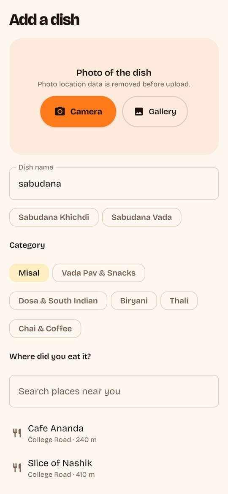

# FoodFeed

A local food app where the unit is **a specific dish at a specific place**, ranked by how many real
people recommend it, whatever the restaurant's overall rating. The full idea, research and plan are in
[`docs/FoodFeed_Android_MVP_Plan.md`](docs/FoodFeed_Android_MVP_Plan.md).

The repository has two parts:

| Part | What | Tech |
|---|---|---|
| [`backend/`](backend) | Self-hosted API, database and photo storage | Node 22 + Fastify, Postgres 16 + PostGIS, Docker Compose |
| [`android/`](android) | The Android app (Android 8.0+) | Kotlin, Jetpack Compose, Material 3, Coil, Retrofit |

The UI borrows patterns people already know: an **Instagram**-style full-screen vertical feed with a
Reels-like action rail, double-tap to recommend and story-style category rings; and **Swiggy**-style
location header, veg/non-veg marks and menu-style dish rows with a Save button on the photo.

## Screenshots

Rendered by the app's screenshot tests with the illustrated demo data (refresh with the **Screenshots** workflow in GitHub Actions).

| Feed | Hidden gems (dark) | Dish | Place |
|---|---|---|---|
|  |  |  |  |
| **Search** | **Saved** | **Post a dish** | **Profile** |
|  |  |  |  |

## Features in this MVP

- Guest browsing (no sign-up wall); sign-in is asked for only on the first recommend, save or post, and the action completes right after sign-in.
- City auto-detect from approximate location (never stored), or pick a city.
- Dish feed with **Top**, **Trending** (last 7 days), **Hidden gems** and **Nearby** tabs, plus category filters.
- Ranking per the plan: recommend 1, save 1.5, tried 2, share 2.5; one person capped at 3 points per dish; 45-day half-life; new accounts count half for their first 24 hours; at least 3 people to enter Top; every 5th card is a new dish so fresh posts get seen. All weights live in the `ranking_config` table.
- "Recommended by N people" counts people who recommended or tried the dish (saves are shown separately). Zero shows "New", never "Recommended by 0".
- Dish page (photos, place, recommenders, Open in Maps, More at this place), place page ranked by recommendations, typo-tolerant search with local spellings ("wada pav" finds Vada Pav), saved list, profiles.
- Post a dish in under 30 seconds: camera or gallery photo, resized on the phone with location data removed, dish-name suggestions, nearby places or a new place (held for review), price, veg, caption, a sponsored/free-food label.
- Safety: report posts/dishes/people, block people, auto-hide after 3 reports from established accounts, an admin moderation screen, rate limits, account deletion in the app and on the web.
- Share links with a web preview page (`/d/<dish>`), plus draft Privacy, Terms and Delete-account pages.

## Run the server (Docker)

Needs Docker with Compose v2.

```bash
git clone https://github.com/aniketpitre/Food-MVP.git && cd Food-MVP
cp .env.example .env
# Edit .env: set POSTGRES_PASSWORD and JWT_SECRET (openssl rand -hex 32), ADMIN_EMAILS, PUBLIC_URL
docker compose up -d --build
scripts/smoke-test.sh            # checks the whole API end to end
```

The API is on port `8080`. On first start it creates the schema, seeds the demo city (Nashik), 12
categories, 30 demo dishes at 12 invented places, and (with `DEMO_ACTIVITY=true`) 40 clearly labelled
`demo_` accounts so every tab has data.

**Before inviting real people:** set `DEMO_ACTIVITY=false`, run
`docker compose exec api node dist/cli.js remove-demo`, replace the illustrated demo images and places
with your own (see the plan, section 7.1), and fill in the bracketed parts of the policy pages.

| Task | Command |
|---|---|
| Logs | `docker compose logs -f api` |
| Nightly backups of the database and photos into `./backups` | `docker compose --profile backup up -d` |
| HTTPS with automatic certificates (set `DOMAIN` in `.env`, open ports 80/443) | `docker compose --profile https up -d` |
| Recompute rankings now | `docker compose exec api node dist/cli.js refresh` |
| Restore a backup | `docker compose exec -T db pg_restore -U foodfeed -d foodfeed --clean < backups/db-<date>.dump` |
| Become admin | put your email in `ADMIN_EMAILS`, restart the api, sign up or sign in |

The database is not exposed outside Docker; only the API is. Photos are stored in the `media` volume.

## Install the Android app

Every push builds an APK in GitHub Actions (artifact **FoodFeed-apk**). To publish one on the
[Releases page](https://github.com/aniketpitre/Food-MVP/releases), either run **Actions → Android → Run
workflow** with a version such as `0.2.0`, or push a tag:

```bash
git tag v0.2.0 && git push origin v0.2.0
```

On the phone: download the APK from Releases, allow "Install unknown apps", open FoodFeed and enter your
server address, e.g. `http://192.168.1.20:8080` (the phone must reach that address; on the same Wi-Fi use
the server's LAN IP). To skip that step for testers, set a repository variable
`FOODFEED_SERVER_URL` (Settings → Secrets and variables → Actions → Variables) before tagging.

Pilot APKs are signed with the public test key in `android/keystore/` so updates install over each other.
For Google Play, create a private upload key and pass it via the `ANDROID_KEYSTORE_*` environment
variables read in `android/app/build.gradle.kts`.

## Develop

```bash
# Backend (needs a Postgres+PostGIS for tests)
docker run -d --name ff-testdb -e POSTGRES_PASSWORD=postgres -p 5433:5432 postgis/postgis:16-3.5
cd backend && npm ci && npm test        # 25 integration tests
npm run dev                             # needs DATABASE_URL and JWT_SECRET

# Android (Android Studio, or JDK 17 + Android SDK 35)
cd android
./gradlew testDebugUnitTest             # logic + screenshot tests
./gradlew recordRoborazziDebug          # writes app/screenshots/*.png
./gradlew assembleDebug                 # app-debug.apk, installs next to the release build
```

In the Android emulator the host machine is `http://10.0.2.2:8080`.

Regenerate the illustrated demo photos with `python3 scripts/make_demo_images.py` (needs Pillow).

## Repository map

```
backend/            API (src/), SQL schema (migrations/), demo seed (src/seed-data.ts, seed/images/), tests
android/            Android app: data/ (API, storage, location, image compression), ui/ (screens), tests
docs/               The plan this MVP implements
scripts/            smoke-test.sh, make_demo_images.py
docker-compose.yml  db + api (+ backup and https profiles)
DECISIONS.md        Choices made while building, and why
```
